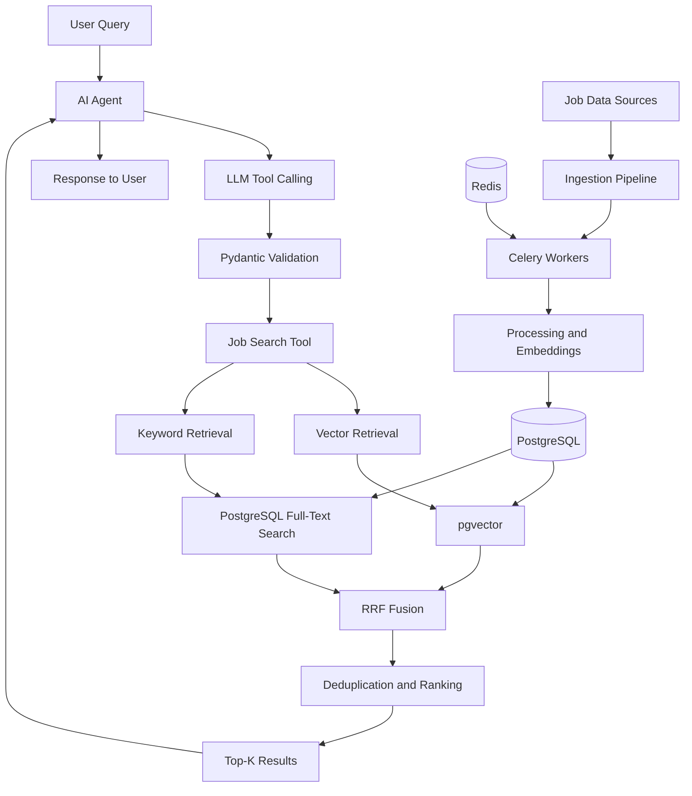
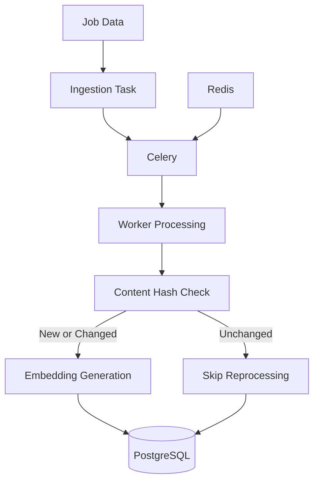

# CareerPilot — AI-Powered Job Search Agent

<p align="center">
  <strong>An intelligent job-search agent combining semantic retrieval, keyword search, ranking, and LLM-based tool orchestration.</strong>
</p>

<p align="center">
  
  
  
  
  
  
</p>

---

## Overview

CareerPilot is an AI-powered job-search agent designed to make job discovery more intelligent, contextual and relevant.

Traditional job-search systems often depend heavily on keyword matching. CareerPilot combines **semantic vector retrieval** and **PostgreSQL full-text search** through **Reciprocal Rank Fusion (RRF)** to retrieve and rank relevant job opportunities.

The system integrates LLM-based tool calling, structured argument validation, session-level memory and asynchronous job ingestion to connect natural-language interactions with a search backend.

CareerPilot also includes a retrieval evaluation pipeline to compare hybrid search against a vector-only baseline and measure search quality and latency.

---

## Key Features

- **Hybrid Retrieval:** Combines vector search and PostgreSQL full-text search.
- **Reciprocal Rank Fusion:** Fuses rankings from independent retrieval systems.
- **Semantic Search:** Finds jobs based on contextual and semantic similarity.
- **Keyword Search:** Retrieves jobs using PostgreSQL full-text search.
- **AI Agent:** Uses LLM tool calling to interact with the job-search backend.
- **Structured Validation:** Validates tool arguments using Pydantic.
- **Session Memory:** Maintains contextual information within a session.
- **Asynchronous Ingestion:** Uses Celery and Redis for background processing.
- **Deduplication:** Uses content hashing to avoid unnecessary reprocessing and embedding generation.
- **Search Optimization:** Uses precomputed full-text search representations and indexing.
- **Retrieval Evaluation:** Benchmarks hybrid retrieval against vector-only search.

---

## System Architecture



### Architecture Components

| Component | Responsibility |
|---|---|
| AI Agent | Interprets user requests and orchestrates search tools |
| LLM Tool Calling | Connects agent reasoning with backend functionality |
| Pydantic | Validates structured tool arguments |
| Vector Retrieval | Retrieves semantically relevant jobs |
| Keyword Retrieval | Retrieves jobs matching textual query terms |
| RRF | Combines rankings from independent retrieval systems |
| PostgreSQL | Stores job data and retrieval information |
| pgvector | Performs vector similarity search |
| PostgreSQL FTS | Performs keyword-based full-text retrieval |
| Celery | Executes asynchronous ingestion tasks |
| Redis | Supports background task processing |
| Embedding Pipeline | Converts textual job content into embeddings |
| Evaluation Pipeline | Measures retrieval performance |

---

## Retrieval Pipeline

CareerPilot uses a hybrid retrieval approach consisting of two independent retrieval systems.

### 1. Semantic Vector Search

User queries are converted into embeddings and compared with job embeddings stored in PostgreSQL using pgvector.

Vector search retrieves jobs based on semantic similarity rather than requiring exact keyword matches.

For example, a query such as:

> Machine Learning Engineer working on NLP

may retrieve jobs mentioning natural language processing, language models, text classification or NLP pipelines even if the exact wording differs.

The vector retrieval system retrieves up to **50 candidate jobs** before fusion.

### 2. PostgreSQL Full-Text Search

CareerPilot also uses PostgreSQL Full-Text Search to retrieve jobs matching query terms.

The keyword retrieval pipeline:

- Extracts query terms.
- Converts them into a PostgreSQL `tsquery`.
- Uses the stored full-text search representation (`fts`).
- Retrieves matching records using the `@@` operator.
- Ranks results using `ts_rank_cd`.
- Retrieves up to **50 candidate jobs** before fusion.

Keyword search helps retrieve opportunities containing specific technologies, skills or job titles.

### 3. Reciprocal Rank Fusion (RRF)

CareerPilot combines the rankings from vector search and keyword search using Reciprocal Rank Fusion.

Rather than combining raw similarity scores and keyword scores, RRF combines the positions of documents in their respective ranked lists.

The RRF score for a document is calculated as:

$$
\operatorname{RRF}(d) = \sum_{r \in R} \frac{1}{k + \operatorname{rank}_r(d)}
$$

Where:

- $d$ represents a job listing.
- $R$ represents the retrieval systems.
- $\operatorname{rank}_r(d)$ represents the rank of the job in retrieval system $r$.
- $k$ is the rank-damping constant.

CareerPilot uses:

$$
k = 60
$$

Each job receives contributions from the retrieval systems in which it appears.

Jobs appearing prominently across multiple retrieval lists can receive higher fused scores.

#### RRF Implementation

```python
RRF_K = 60

def _rrf(*ranked_lists):
    fused = {}

    for rows in ranked_lists:
        seen = set()
        rank = 0

        for r in rows:
            key = _key(r)

            if key in seen:
                continue

            seen.add(key)
            rank += 1

            entry = fused.setdefault(
                key,
                {**r, "score": 0.0}
            )

            entry["score"] += 1.0 / (RRF_K + rank)

    return sorted(
        fused.values(),
        key=lambda r: r["score"],
        reverse=True
    )
```

### 4. Deduplication

CareerPilot identifies duplicate job listings using a normalized key consisting of:

- Job title
- Company
- Location

This prevents multiple postings of the same job from unnecessarily occupying the final ranked result list.

### 5. Filtering

The search pipeline supports:

- Location-based filtering.
- Remote-only filtering.

These filters are applied to both retrieval legs before fusion.

---

## Retrieval Evaluation

CareerPilot was evaluated by comparing hybrid retrieval against a vector-only baseline.

The evaluation was conducted using **30 queries** with keyword-based relevance judgments based primarily on job titles.

### Benchmark Results

| Metric | Vector Search | Hybrid Search |
|---|---:|---:|
| Precision@5 | 0.633 | **0.680** |
| Hit@5 | 1.000 | 1.000 |
| P50 Latency | 43 ms | 55 ms |
| P95 Latency | 54 ms | 85 ms |

### Precision@5

| Retrieval Method | Precision@5 |
|---|---:|
| Vector Search | 0.633 |
| Hybrid Search | **0.680** |

Hybrid retrieval achieved a higher Precision@5 on the evaluation set.

### Query-Level Comparison

| Outcome | Queries |
|---|---:|
| Hybrid improved | 12 |
| Hybrid regressed | 8 |
| Unchanged | 10 |
| **Total** | **30** |

The evaluation indicates that hybrid retrieval improved precision on a subset of queries, while some queries experienced regressions.

These results represent an initial benchmark rather than a comprehensive ranking evaluation. The evaluation set is relatively small, and relevance judgments are keyword-based.

---

## Retrieval Performance Optimization

An initial implementation of hybrid retrieval exhibited significantly higher latency than expected.

### Before Optimization

| Metric | Latency |
|---|---:|
| P50 | 2,279 ms |
| P95 | 2,678 ms |

### After Optimization

| Metric | Latency |
|---|---:|
| P50 | 55 ms |
| P95 | 85 ms |

### Optimization Approach

The performance bottleneck was associated with PostgreSQL full-text retrieval.

The optimization involved:

- Precomputing the full-text search representation in an `fts` column.
- Using a GIN index for full-text search.
- Avoiding unnecessary full-text computation during search queries.

These changes significantly reduced hybrid retrieval latency while preserving the evaluated ranking results.

The optimization focused on improving the query execution path rather than changing the retrieval ranking algorithm.

---

## AI Agent

CareerPilot integrates LLM-based tool calling to connect natural-language interactions with backend job-search functionality.

### Agent Capabilities

- Interprets natural-language job-search requests.
- Invokes the job-search tool.
- Passes structured search parameters.
- Uses validated tool arguments.
- Maintains session-level context.
- Handles malformed tool-call arguments.

### Tool Validation

Tool arguments are validated using Pydantic to help ensure that the backend receives structured and valid inputs.

This provides a validation layer between the LLM and backend operations.

---

## Asynchronous Job Ingestion

CareerPilot uses Celery and Redis to support asynchronous job ingestion and processing.

### Ingestion Workflow



### Pipeline Features

- Background task processing.
- Content-hash-based deduplication.
- Avoids unnecessary embedding generation for unchanged content.
- Retry handling for task failures.
- Separation of ingestion and search workloads.

---

## Technology Stack

| Technology | Usage |
|---|---|
| Python | Backend development |
| PostgreSQL | Relational data storage |
| pgvector | Vector similarity search |
| PostgreSQL Full-Text Search | Keyword retrieval |
| Redis | Background task infrastructure |
| Celery | Asynchronous task processing |
| Docker | Containerization |
| Embedding Models | Text vectorization |
| LLM | Agent reasoning and tool calling |
| Pydantic | Structured validation |

---

## Project Structure

```text
job-agent/
├── app/
│   ├── __init__.py
│   ├── agent.py
│   ├── config.py
│   ├── db.py
│   ├── embeddings.py
│   ├── ingest.py
│   ├── main.py
│   ├── search.py
│   └── worker.py
├── evals/
│   ├── __init__.py
│   ├── queries.json
│   └── run_eval.py
├── .dockerignore
├── .gitignore
├── docker-compose.yml
├── Dockerfile
├── requirements.txt
└── schema.sql
```

### Core Files

| File | Description |
|---|---|
| `app/agent.py` | AI agent and tool orchestration |
| `app/config.py` | Application configuration |
| `app/db.py` | Database connectivity |
| `app/embeddings.py` | Embedding generation |
| `app/ingest.py` | Job ingestion pipeline |
| `app/main.py` | Application entry point |
| `app/search.py` | Vector retrieval, keyword search and RRF |
| `app/worker.py` | Background worker |
| `evals/queries.json` | Retrieval evaluation queries |
| `evals/run_eval.py` | Evaluation and benchmarking |
| `schema.sql` | Database schema |
| `docker-compose.yml` | Container orchestration |
| `Dockerfile` | Application container configuration |

---

## Getting Started

### Prerequisites

- Python
- Docker
- Docker Compose
- Required API keys
- PostgreSQL with pgvector support

### 1. Clone the Repository

```bash
git clone https://github.com/dashsubhasis95-cpu/job-agent.git

cd job-agent
```

### 2. Configure Environment Variables

Create your environment configuration using the project's environment template or configuration instructions.

Configure the required API keys and application settings.

> Never commit API keys, credentials or private environment files.

### 3. Start the Services

```bash
docker compose up --build
```

### 4. Verify the Backend

If the health endpoint is enabled:

```bash
curl.exe http://localhost:8000/health
```

Example response:

```json
{
  "status": "ok",
  "jobs_indexed": 1411
}
```

---

## Limitations

- The retrieval evaluation currently uses 30 queries.
- Relevance judgments are keyword-based and primarily title-oriented.
- Hybrid retrieval can regress on individual queries.
- Hit@5 is not sufficiently discriminative in the current evaluation set.
- The job corpus is dependent on the available ingestion sources.
- Ranking quality has not yet been validated through large-scale human relevance judgments.

---

## Future Improvements

- Expand the evaluation dataset.
- Introduce human-annotated relevance judgments.
- Evaluate NDCG@K, Recall@K and MRR.
- Experiment with different RRF damping constants.
- Introduce learned ranking and reranking models.
- Improve query understanding and personalization.
- Expand job ingestion sources.
- Add automated retrieval regression testing.
- Monitor search latency and retrieval quality.
- Improve agent evaluation and tool-call reliability.

---

## Author

**Subhasis Dash**

GitHub: [@dashsubhasis95-cpu](https://github.com/dashsubhasis95-cpu)

Project Repository: [CareerPilot](https://github.com/dashsubhasis95-cpu/job-agent)

---

<p align="center">
  Built to explore intelligent retrieval, AI agents and practical search systems.
</p>
